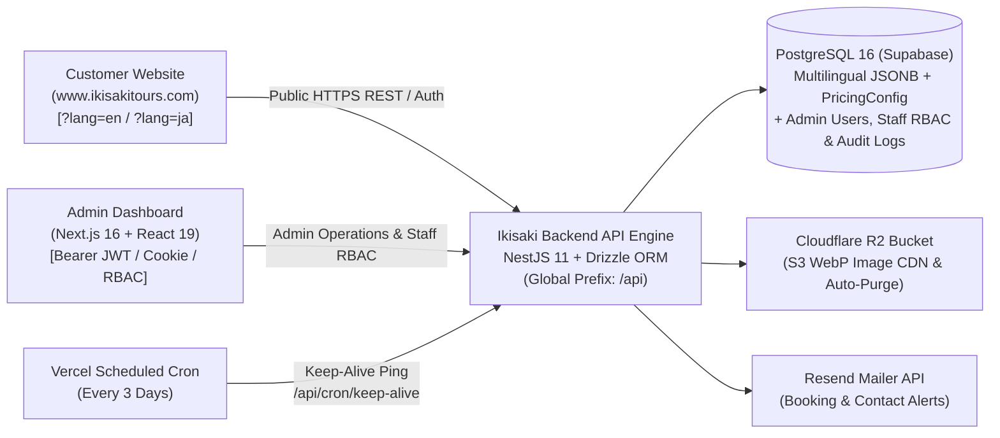

<div align="center">


# Ikisaki Tours — Enterprise Backend Engine

**Centralized Multilingual RESTful API Engine, Dynamic Pricing, 10-Role RBAC & Operations Service for [www.ikisakitours.com](https://www.ikisakitours.com)**

[](https://nestjs.org/)
[](https://www.typescriptlang.org/)
[](https://www.postgresql.org/)
[](https://orm.drizzle.team/)
[](https://developers.cloudflare.com/r2/)
[](https://supabase.com/)
[](https://vercel.com/)

[Live Backend API](https://ikisakitours-backend.vercel.app) · [Admin Dashboard](https://ikisakitours-admin-panel.vercel.app) · [Customer Website](https://www.ikisakitours.com) · [API Documentation](#api-service-layer-reference)

</div>

---

## Table of Contents

- [Overview](#overview)
- [System Architecture](#system-architecture)
- [Module Directory (All 21 Domains)](#module-directory-all-21-domains)
- [Core Engineering Highlights](#core-engineering-highlights)
  - [1. Unified Dynamic Group Pricing (`pricingConfig`)](#1-unified-dynamic-group-pricing-pricingconfig)
  - [2. Dual-Persona Multilingual `JSONB` Content Resolution](#2-dual-persona-multilingual-jsonb-content-resolution)
  - [3. Availability Calendar, Color-Coded Blackouts & Multi-Tour Closures](#3-availability-calendar-color-coded-blackouts--multi-tour-closures)
  - [4. Resilient Serverless Pipeline, Cloudflare R2 & Keep-Alive Cron](#4-resilient-serverless-pipeline-cloudflare-r2--keep-alive-cron)
  - [5. Enterprise Admin Security Engine, Dual Bearer/Cookie Auth & Native 2FA (TOTP)](#5-enterprise-admin-security-engine-dual-bearercookie-auth--native-2fa-totp)
  - [6. 10-Role Staff Management & Granular Access Control Engine (RBAC)](#6-10-role-staff-management--granular-access-control-engine-rbac)
  - [7. Automated Cloudflare R2 Asset Lifecycle & Orphaned Avatar Deletion](#7-automated-cloudflare-r2-asset-lifecycle--orphaned-avatar-deletion)
  - [8. Zero-Trust Customer Account Suspension & Branded Customer Reference IDs](#8-zero-trust-customer-account-suspension--branded-customer-reference-ids)
  - [9. Private Tour Services, Chauffeur Hire & Airport Transfer Engine (`/services`)](#9-private-tour-services-chauffeur-hire--airport-transfer-engine-services)
  - [10. Enterprise Customer 2FA (RFC 6238 TOTP) & Zero-Trust Social OAuth Challenge](#10-enterprise-customer-2fa-rfc-6238-totp--zero-trust-social-oauth-challenge)
- [API Service Layer Reference](#api-service-layer-reference)
  - [Staff & Team RBAC Management (`/api/admin/staff`)](#staff--team-rbac-management-apiadminstaff)
  - [Admin Authentication, Profile & 2FA (`/api/admin/auth`)](#admin-authentication-profile--2fa-apiadminauth)
  - [Customer Authentication, Security & Accounts (`/api/auth`)](#customer-authentication-security--accounts-apiauth)
  - [Social OAuth 2.0 Integration (`/api/social-auth`)](#social-oauth-20-integration-apisocial-auth)
  - [Tour Services & Transportation Requests (`/api/services`)](#tour-services--transportation-requests-apiservices)
  - [Tour Packages & Catalog (`/api/addpackages`)](#tour-packages--catalog-apiaddpackages)
  - [Availability Calendar (`/api/availability`)](#availability-calendar-apiavailability)
  - [Destinations Guide (`/api/destinations`)](#destinations-guide-apidestinations)
  - [Tour Bookings (`/api/package-bookings`)](#tour-bookings-apipackage-bookings)
  - [Travel Blogs (`/api/blogs`)](#travel-blogs-apiblogs)
  - [Comments & Reviews (`/api/comments` & `/api/package-reviews`)](#comments--reviews-apicomments--apipackage-reviews)
  - [Legal Documents (`/api/legaldocs`)](#legal-documents-apilegaldocs)
  - [Media Uploads & Storage (`/api/uploads`)](#media-uploads--storage-apiuploads)
  - [Inquiries, Feedback & System](#inquiries-feedback--system)
- [Tech Stack](#tech-stack)
- [Project Structure](#project-structure)
- [Getting Started](#getting-started)
- [Database Operations](#database-operations)
- [Deployment (Vercel)](#deployment-vercel)
- [Production Readiness Checklist](#production-readiness-checklist)
- [Credits & License](#credits--license)

---

## Overview

The **Ikisaki Tours Backend Engine** is the high-performance, enterprise-grade RESTful API service powering **Ikisaki Tours** — a luxury private tour operator in Sri Lanka serving international travelers with native **English (`EN`)** and **Japanese (`JA`)** localization plus extensible multi-language capabilities.

The backend acts as the single source of truth for both the customer-facing booking web application ([www.ikisakitours.com](https://www.ikisakitours.com)) and the administrative control dashboard ([ikisakitours-admin-panel.vercel.app](https://ikisakitours-admin-panel.vercel.app)).

Engineered on **NestJS 11** and **TypeScript**, the platform utilizes **Drizzle ORM** with **PostgreSQL (Supabase)**, native `jsonb` schema structures, **Cloudflare R2** S3-compatible media distribution, and serverless edge functions on **Vercel**.

> [!TIP]
> **API Base Routing & Security:** All routes are prefixed with `/api`. Administrative mutation endpoints (POST, PATCH, DELETE) require either a verified Bearer token/HttpOnly session cookie or the `x-admin-key` header matching `ADMIN_API_KEY`. Public GET endpoints automatically negotiate and return clean localized data when given `?lang=en` or `?lang=ja`.

> [!IMPORTANT]
> **Supabase Connection Pooling:** High-concurrency operations connect through the Supabase Transaction Pooler (`aws-0-ap-northeast-2.pooler.supabase.com:5432`) using `sslmode=require`. An automated 3-day serverless cron ping (`/api/cron/keep-alive`) prevents database sleep cycles.

---

## System Architecture



---

## Module Directory (All 21 Domains)

| Domain                           | Route Mount                                | Operational & Business Capabilities                                                                                                                                                                |
| :------------------------------- | :----------------------------------------- | :------------------------------------------------------------------------------------------------------------------------------------------------------------------------------------------------- |
| **Staff & Team RBAC**            | `/api/admin/staff`                         | 10-role enterprise staff directory, role assignments, account suspension/activation, session revocation, credential reset & audit logging                                                          |
| **Admin Auth & Security**        | `/api/admin/auth`                          | Enterprise authentication: Bearer JWT + HttpOnly cookies, session rotation, account lockouts, self-service profile, password change, and native RFC 6238 TOTP 2FA with QR codes                    |
| **Customer Accounts & Security** | `/api/auth`                                | Customer registration, login, profile management, Zero-Trust real-time suspension enforcement, branded reference ID (`IKISAKI-XXXXXX`), Dual-Login password creation, and native RFC 6238 TOTP 2FA |
| **Social OAuth 2.0**             | `/api/social-auth`                         | Google, Facebook, and Instagram federated OAuth with Zero-Trust 2FA ticket challenge redirection and account suspension protection                                                                 |
| **Tour Services & Transfers**    | `/api/services`                            | Private chauffeur hire, airport & intercity transfers, and custom tailor-made tour requests with passenger breakdowns, language preference, and dynamic quotes                                     |
| **Tour Packages**                | `/api/addpackages`                         | One-day & multi-day packages, 18 badge categories, dynamic group pricing tiers, passenger rules, custom add-ons, dynamic meals/hotels, and like counters                                           |
| **Tour Catalog**                 | `/api/tours`                               | Lightweight public tour catalog query and individual tour detail listing endpoints                                                                                                                 |
| **Availability Calendar**        | `/api/availability`                        | Central booking calendar, blackout dates, multi-color hex coding, tour-type closures, and bilingual client closure notes                                                                           |
| **Destinations**                 | `/api/destinations`                        | Sri Lanka travel hubs, geographic coordinates (`lat`, `lng`), interactive map markers, photo galleries, and slug lookup                                                                            |
| **Bookings & Orders**            | `/api/package-bookings`                    | Customer tour reservations, anti-tampering price recalculation, adult/child/infant breakdown, and status lifecycle (`pending`, `confirmed`, `completed`, `cancelled`)                              |
| **Service Pricing**              | `/api/service-pricing`                     | Supplementary service tariffs: Private Chauffeur, Airport Transfers, and Custom Tailor-Made tour rate cards                                                                                        |
| **Service Guidelines**           | `/api/services/notes` & `/api/tourservice` | Vehicle specifications, luggage/pax limits, fuel/toll policies, and bilingual Japanese/English service guidelines                                                                                  |
| **Travel Blog CMS**              | `/api/blogs`                               | Multilingual travel articles, auto-slugification, tag taxonomies, reader card previews, and persistent user like tracking                                                                          |
| **Comments & Reviews**           | `/api/comments`                            | Unified Website Feedback & Tour Package Reviews, star ratings, moderation workflows (`approved`, `hidden`), and direct Admin Replies                                                               |
| **Inquiries & Contacts**         | `/api/contacts`                            | Customer contact form lead capture, inquiry categorization, and transactional email dispatch via Resend                                                                                            |
| **Legal & Compliance**           | `/api/legaldocs`                           | Dynamic compliance CMS: Terms of Service, Privacy Policy, Cookie Policy, and Cancellation terms with client auto-translation                                                                       |
| **Cookie Consent**               | `/api/cookies`                             | GDPR & ePrivacy compliance tracking recording visitor consent choices per user identifier                                                                                                          |
| **Customer Support**             | `/api/faqs`                                | Categorized multilingual support Q&A pairs with admin management                                                                                                                                   |
| **Newsletter Leads**             | `/api/newsletter`                          | Email marketing lead capture with duplicate prevention and unsubscribe handling                                                                                                                    |
| **Media & Asset CDN**            | `/api/uploads`                             | High-speed single and batch `.webp` uploads to Cloudflare R2 bucket with automated folder tagging and orphan asset cleanup                                                                         |
| **System & Crons**               | `/api/cron`                                | Automated Supabase pooler warmth maintenance ping avoiding free-tier inactivity timeouts                                                                                                           |

---

## Core Engineering Highlights

### 1. Unified Dynamic Group Pricing (`pricingConfig`)

The backend pricing engine supports realistic Sri Lanka private vehicle capacities and room-sharing economics:

| Tier                         | Min Pax | Max Pax | Sri Lanka Vehicle Class                |
| :--------------------------- | :-----: | :-----: | :------------------------------------- |
| **Solo**                     |   `1`   |   `1`   | Sedan Car (Prius / Axio)               |
| **Couple**                   |   `2`   |   `2`   | Sedan Car (1 Double/Twin Room)         |
| **Small Group**              |   `3`   |   `4`   | Flat-Roof Van / Mini-Van (KDH / Noah)  |
| **Medium Group**             |   `5`   |   `7`   | High-Roof Van (Toyota KDH High Roof)   |
| **Large Group**              |   `8`   |  `15`   | Mini Coach (Mitsubishi Rosa / Coaster) |
| **Coach Group** _(Optional)_ |  `16`   |  `30+`  | Full-Size Luxury Coach (33–45 Seater)  |

- **Passenger Category Rules**:
  - `couplePricingType`: Set to `auto_tier` (calculates 2 × couple rate) or `fixed` (flat rate).
  - `childRateType`: Set to `percentage` (e.g. `50%` of adult rate) or `fixed` dollar amount.
  - `infantPrice`: Default `$0` (free of charge for infant seating).
- **Tour Add-Ons**: Multilingual custom optional items supporting `per_person`, `per_room`, and `per_booking` (flat fee) calculation models.

<details>
<summary><strong>View Complete <code>pricingConfig</code> JSONB Schema Example</strong></summary>

```json
{
  "tiers": [
    {
      "minPax": 1,
      "maxPax": 1,
      "pricePerPerson": 850,
      "label": "Solo (1 Person)"
    },
    {
      "minPax": 2,
      "maxPax": 2,
      "pricePerPerson": 580,
      "label": "Couple (2 Persons)"
    },
    {
      "minPax": 3,
      "maxPax": 4,
      "pricePerPerson": 460,
      "label": "Small Group (3-4 Persons)"
    },
    {
      "minPax": 5,
      "maxPax": 7,
      "pricePerPerson": 390,
      "label": "Medium Group (5-7 Persons)"
    },
    {
      "minPax": 8,
      "maxPax": 15,
      "pricePerPerson": 320,
      "label": "Large Group (8-15 Persons)"
    }
  ],
  "passengerPricing": {
    "couplePricingType": "auto_tier",
    "coupleFixedPrice": 1160,
    "childRateType": "percentage",
    "childRateValue": 50,
    "infantPrice": 0
  },
  "options": [
    {
      "id": "opt-single-supplement",
      "name": {
        "en": "Single Room Accommodation Supplement",
        "ja": "シングルルーム（一人部屋）確約追加代金"
      },
      "price": 180,
      "calculationType": "per_room"
    },
    {
      "id": "opt-first-class-train",
      "name": {
        "en": "Scenic Blue Train 1st Class Ticket Upgrade",
        "ja": "絶景高原列車 1等指定席アップグレード"
      },
      "price": 25,
      "calculationType": "per_person"
    },
    {
      "id": "opt-vip-vehicle-upgrade",
      "name": {
        "en": "VIP Luxury Vehicle Upgrade (Alphard / Mercedes)",
        "ja": "VIPラグジュアリー車両アップグレード"
      },
      "price": 150,
      "calculationType": "per_booking"
    }
  ]
}
```

</details>

---

### 2. Dual-Persona Multilingual `JSONB` Content Resolution

To maximize developer ergonomics and avoid maintaining duplicate database tables for every language, text fields are stored as PostgreSQL `jsonb` locale dictionaries (`{ "en": "...", "ja": "..." }`):

- **Public Client Mode (`?lang=ja` or `?lang=en`)**: Endpoints automatically flatten and map dictionary structures into clean, single-language strings and string arrays (`getLocalizedField`, `getLocalizedArray`, `getLocalizedList`), with seamless automatic fallback to English (`en`) if a translation is pending.
- **Admin Dashboard Mode (Omitted `lang` query)**: Endpoints return raw, complete multilingual JSON dictionaries without flattening, allowing the Admin Panel to populate bilingual tabs and save text without data truncation.
- **Dynamic Array Itineraries**: Daily itinerary items store dynamic string arrays for `meals` and `accommodation` (`Record<string, string[] | string>`), enabling multiple items per day (e.g. `["Breakfast Included", "Lunch Included", "Dinner at Hotel"]`) while maintaining backward compatibility with legacy single strings.

---

### 3. Availability Calendar, Color-Coded Blackouts & Multi-Tour Closures

The availability system synchronizes closed booking dates between admin staff and customer checkout flows:

- **Date Details Grid**: Dates can be blocked for `all`, `oneday tours`, `multiday tours`, `custom made tours`, `private charter`, or `transfer`.
- **Multi-Color Visuals**: Predefined color palettes (`rose`, `emerald`, `blue`, `purple`, `gold`, `orange`, `zinc`) and custom HEX codes (`#f43f5e`, `#10b981`, etc.) for calendar badges.
- **Bilingual Reasons**: Admins input reasons in English and Japanese (`notes: { en: "Perahera Festival Holiday", ja: "ペラヘラ祭り期間のため休業" }`), and the backend dynamically resolves the appropriate `note` for client date-pickers.

---

### 4. Resilient Serverless Pipeline, Cloudflare R2 & Keep-Alive Cron

- **Cloudflare R2 Object Storage**: S3-compatible asset pipeline using `@aws-sdk/client-s3` with custom public CDN domains (`R2_PUBLIC_URL`). Zero egress bandwidth fees for heavy tour image galleries.
- **Automated Anti-Pause Cron**: Vercel Cron triggers `GET /api/cron/keep-alive` every 3 days at midnight, executing `SELECT 1` on the PostgreSQL database to keep the Supabase Free Tier project active.

---

### 5. Enterprise Admin Security Engine, Dual Bearer/Cookie Auth & Native 2FA (TOTP)

The administrative control plane (`/api/admin/auth`) is engineered with zero-compromise enterprise security:

- **Dual Bearer Token & HttpOnly Cookie Extraction**: Seamless cross-origin support extracting `Bearer <token>` from the `Authorization` header with graceful fallback to HttpOnly cookies (`admin_session`, `admin_token`, `jwt`, `token`) and `x-admin-key` Super Admin service bypass.
- **Extended 3-Hour Access Token Lifecycle**: Admin access tokens have an extended 3-hour (`3h`) lifespan (with matching 3-hour cookie `maxAge`) allowing back-office operators and administrative staff to work comfortably throughout their workday without mid-workflow session expirations or constant re-login interruptions.
- **Zero-Dependency Native RFC 6238 TOTP Engine**: Custom-built on Node.js `crypto` with zero external ESM dependencies, completely eliminating serverless `ERR_REQUIRE_ESM` runtime incompatibilities. 100% compliant with Google Authenticator, Microsoft Authenticator, Authy, and 1Password with QR code data URLs via `qrcode`.
- **Brute-Force & Account Lockout Defense**: Enforces consecutive failed login tracking with automatic 30-minute account locks upon 5 consecutive failures.
- **Token Rotation & Session Reuse Attack Detection**: Issues rotating 7-day refresh tokens. If a previously revoked refresh token is presented, all active sessions for that admin user are instantly invalidated.
- **Enterprise Security Audit Logging**: Every critical security action (`LOGIN_SUCCESS`, `LOGIN_FAILED`, `PROFILE_UPDATED`, `PASSWORD_CHANGED`, `2FA_ENABLED`, `2FA_DISABLED`, `TOKEN_REFRESH`, `R2_AVATAR_CLEANUP`) is immutably logged in `admin_audit_logs` with client IP and User-Agent.

---

### 6. 10-Role Staff Management & Granular Access Control Engine (RBAC)

The Staff Management Engine (`/api/admin/staff`) enforces strict Role-Based Access Control (RBAC) across all administrative functions using NestJS metadata decorators (`@Roles()`) and the `RolesGuard`:

| Specialized Role            | System Scope & Permissions                                                                                    |
| :-------------------------- | :------------------------------------------------------------------------------------------------------------ |
| **`SUPER_ADMIN`**           | Unrestricted master access across all platform modules, system secrets, staff management, and audit logs      |
| **`OPERATIONS_MANAGER`**    | Tour management, reservation approvals, booking status changes, driver assignments, and calendar availability |
| **`TOUR_EXECUTIVE`**        | Tour package content creation, pricing tiers, badges, itinerary editing, and destination hubs                 |
| **`BOOKING_AGENT`**         | Customer booking oversight, booking inquiry responses, and customer communication                             |
| **`CONTENT_CREATOR`**       | Travel blog posts, destination guides, FAQ entries, and multimedia uploads                                    |
| **`CUSTOMER_SUPPORT`**      | Contact inquiry handling, user reviews, customer feedback, and moderation replies                             |
| **`FINANCE_OFFICER`**       | Pricing tariffs, group rate cards, payment verification, and revenue audit tracking                           |
| **`TRANSPORT_COORDINATOR`** | Vehicle fleet specifications, chauffeur hire requests, airport transfer bookings, and transport guidelines    |
| **`ANALYST`**               | Read-only analytics, visitor engagement tracking, and system performance telemetry                            |
| **`AUDITOR`**               | Read-only access to immutable audit logs (`admin_audit_logs`) and system compliance                           |

- **Self-Protection Guardrails**: Built-in rules prevent administrators from suspending or deleting their own accounts (`Cannot suspend/delete your own administrator account`).
- **Immediate Session Revocation**: Suspending a staff member or resetting their password instantly revokes all active refresh tokens in `admin_sessions`.

---

### 7. Automated Cloudflare R2 Asset Lifecycle & Orphaned Avatar Deletion

To prevent accumulation of orphaned files and control storage costs, the backend implements automated Cloudflare R2 cleanup:

- **`extractR2KeyFromUrl` Utility**: Intelligently extracts relative R2 object keys from public development domains (`*.r2.dev`), custom production CDNs (`assets.ikisakitours.com`), or relative paths, while strictly ignoring base64 data URIs and external Google/Facebook profile photos.
- **Automatic Profile Avatar Purge**: When an admin, staff member, or customer uploads a new profile picture (`PATCH /api/admin/auth/profile` or `PATCH /api/auth/me/avatar`), or updates/removes their photo (`PATCH /api/auth/me` with `avatarUrl: null`), the previous image file is automatically purged from the Cloudflare R2 bucket.
- **Cascade Deletion on Account Removal**: Deleting a staff account (`DELETE /api/admin/staff/:id`) or customer account (`DELETE /api/auth/me`) automatically inspects and purges their avatar image from R2 before deleting the database record.
- **Non-Blocking Resilience**: Asset cleanup errors are safely caught, logged to console, and recorded as `R2_AVATAR_CLEANUP` in `admin_audit_logs` without failing primary database operations.

---

### 8. Zero-Trust Customer Account Suspension & Branded Customer Reference IDs

A robust, real-time protection layer aligns the Admin Panel's `hasAccess` toggle with the Customer Website to enforce instantaneous account suspension:

#### Zero-Trust `JwtAuthGuard`

- On **every** authenticated customer request, `JwtAuthGuard` queries PostgreSQL in real-time.
- If `hasAccess === false`, the request is immediately terminated with a structured `403 ForbiddenException`:
  ```json
  {
    "statusCode": 403,
    "error": "ACCOUNT_SUSPENDED",
    "message": "Your account access has been restricted by administration.",
    "user": {
      "id": "uuid",
      "customerReferenceId": "IKISAKI-8F42M9",
      "email": "customer@example.com",
      "firstname": "Pramod",
      "lastname": "Siriwardhana",
      "hasAccess": false
    }
  }
  ```
- **Login Defense**: Suspended customers attempting to log in via standard credentials (`POST /api/auth/login`) or Social OAuth (Google, Instagram, Facebook) receive the structured 403 response, allowing the frontend to render the `<AccessRestricted />` screen.
- **Account Recovery & 2FA Suspension Defense**: The OTP password reset flow (`POST /api/auth/reset-password`) and 2FA challenge verification (`POST /api/auth/2fa/verify-challenge`) also enforce real-time `hasAccess` validation, guaranteeing suspended accounts cannot circumvent restrictions via password resets or multi-factor challenges.
- **Dual-Login Creation for Social OAuth Users**: Users who originally registered via 1-click Social OAuth (Google, Facebook, Instagram) can establish an independent email/password credential at any time using the Forgot Password flow (`POST /api/auth/forgot-password` + `POST /api/auth/reset-password`). Once set, they can sign in seamlessly via either Social OAuth OR traditional password credentials without account duplication.
- **Mutation Guard**: Submitting comments (`/api/comments`), tour reviews (`/api/package-reviews`), service bookings (`/api/services/*`), or package bookings (`/api/package-bookings`) verifies caller status and rejects suspended users while **public guest bookings and inquiries remain 100% functional**.

#### Branded Customer Reference ID (`customerReferenceId`)

- Every customer is automatically assigned a clean 6-character alphanumeric reference code (e.g. `IKISAKI-8F42M9`).
- **Clean Character Set**: Built via `generateCustomerReferenceId()`, strictly excluding confusing characters (`0`, `O`, `1`, `I`).
- **Automatic Backfill**: Existing customer records lacking a reference ID are seamlessly backfilled upon their next login or `/api/auth/me` request.

---

### 9. Private Tour Services, Chauffeur Hire & Airport Transfer Engine (`/services`)

Unified management for private bespoke travel experiences:

- **Airport & Intercity Transfers (`transfer`)**: Starting base rates mapped from vehicle class specifications with distance-based dynamic quotations issued via email.
- **Private Chauffeur Hire (`chauffeur`)**: Tiered pricing support (_With Driver_, _With Guide_, or _With Driver & Guide_).
- **Custom Tailor-Made Tours (`custom`)**: Full bespoke itinerary requests capturing destination interests and special requests.
- **Bilingual Guest Communication (`language`)**: Preferred guest communication language (English, Japanese, German, French) stored per service request.
- **Granular Travelers Breakdown**: Structured JSON breakdown storing `{ adults, couples, children, infants }` for operational transport preparation.

---

### 10. Enterprise Customer 2FA (RFC 6238 TOTP) & Zero-Trust Social OAuth Challenge

To provide defense-grade security for registered travelers, the customer authentication layer incorporates a native, zero-dependency RFC 6238 TOTP Two-Factor Authentication engine supporting **Google Authenticator**, **Authy**, and **1Password**:

#### 1. Setup & Secret Provisioning (`POST /api/auth/2fa/generate`)

- Authenticated customers generate a cryptographically random 20-byte Base32 secret key.
- Generates an `otpauth://` QR Code Data URL formatted as:
  `otpauth://totp/Ikisaki%20Tours:${user.email}?secret=${secret}&issuer=Ikisaki%20Tours&algorithm=SHA1&digits=6&period=30`
- Persists pending secret temporarily in `users.twoFactorTempSecret` without enabling 2FA until confirmed.

#### 2. Verification & Activation (`POST /api/auth/2fa/enable`)

- Customer scans the QR code in their Authenticator app and submits their first live 6-digit TOTP code.
- Backend verifies the token with a ±30s drift window tolerance.
- Upon successful verification, promotes `twoFactorTempSecret` to permanent `twoFactorSecret`, nulls the temp secret, and sets `isTwoFactorEnabled: true`.

#### 3. Strict Zero-Trust Social OAuth Challenge (Google, Facebook, Instagram)

- **Problem**: In standard OAuth 2.0 implementations, social login redirects can inadvertently bypass application-level 2FA.
- **Solution (Gold Standard Zero-Trust)**: When a customer with `isTwoFactorEnabled: true` logs in via **Google 1-Click**, **Facebook**, or **Instagram**, the backend halts session cookie generation.
- The callback redirect safely routes the user to:
  ```text
  /login?step=2fa_challenge&ticket=${shortLivedJwtTicket}&email=${user.email}&ref=${customerReferenceId}
  ```
- The frontend immediately displays the branded 6-digit Authenticator verification prompt.

#### 4. Unified Challenge Verification (`POST /api/auth/2fa/verify-challenge`)

- Both Social OAuth and Email/Password flows share a single high-security verification endpoint:
  ```json
  {
    "ticket": "eyJhbGciOi...",
    "totpCode": "123456",
    "staySignedIn": true
  }
  ```
- Validates the 5-minute single-use ticket, verifies the live 6-digit TOTP code, checks account suspension (`hasAccess`), and sets the HttpOnly session cookie (`token`).

#### 5. Safe 2FA Deactivation (`POST /api/auth/2fa/disable`)

- Follows industry best practices requiring identity re-verification before multi-factor defense is stripped:
  - Users with password credentials supply their current account password.
  - Social OAuth users (or password users) supply a live 6-digit TOTP code from their authenticator app.
- Upon successful verification, securely nulls `twoFactorSecret` and sets `isTwoFactorEnabled: false`.

---

## API Service Layer Reference

### Staff & Team RBAC Management (`/api/admin/staff`)

All staff endpoints require `@UseGuards(AdminAuthGuard, RolesGuard)` and appropriate role permissions.

| Method   | Endpoint                              |                 Allowed Roles                  | Description                                                               |
| :------- | :------------------------------------ | :--------------------------------------------: | :------------------------------------------------------------------------ |
| `GET`    | `/api/admin/staff`                    | `SUPER_ADMIN`, `OPERATIONS_MANAGER`, `AUDITOR` | List all internal staff members sorted by creation date                   |
| `POST`   | `/api/admin/staff`                    |                 `SUPER_ADMIN`                  | Provision a new staff account with initial role and credentials           |
| `PATCH`  | `/api/admin/staff/:id/role`           |                 `SUPER_ADMIN`                  | Update staff member's administrative role                                 |
| `PATCH`  | `/api/admin/staff/:id/status`         |      `SUPER_ADMIN`, `OPERATIONS_MANAGER`       | Toggle account status (Active / Suspended); revokes sessions if suspended |
| `POST`   | `/api/admin/staff/:id/reset-password` |                 `SUPER_ADMIN`                  | Administrative password reset; invalidates active sessions                |
| `DELETE` | `/api/admin/staff/:id`                |                 `SUPER_ADMIN`                  | Permanently delete staff member and purge their avatar from Cloudflare R2 |

---

### Admin Authentication, Profile & 2FA (`/api/admin/auth`)

| Method  | Endpoint                          |      Auth       | Description                                                                                                                            |
| :------ | :-------------------------------- | :-------------: | :------------------------------------------------------------------------------------------------------------------------------------- |
| `POST`  | `/api/admin/auth/login`           |     Public      | Admin login with bcrypt (12 rounds), returns `token`, `accessToken`, and `user` payload, sets 3-hour session & 7-day refresh cookies   |
| `POST`  | `/api/admin/auth/logout`          |  Session / JWT  | Revokes current refresh token session and clears authentication cookies                                                                |
| `GET`   | `/api/admin/auth/me`              | Bearer / Cookie | Fetch profile of currently authenticated admin (`id`, `email`, `fullName`, `role`, `avatarUrl`, `isTwoFactorEnabled`)                  |
| `POST`  | `/api/admin/auth/refresh`         |     Cookie      | Session refresh with token rotation & reuse detection                                                                                  |
| `PATCH` | `/api/admin/auth/profile`         | Bearer / Cookie | Self-service update for display name (`fullName`), WebP avatar (`avatarUrl`), and auto-purges previous avatar (`oldAvatarUrl`) from R2 |
| `PATCH` | `/api/admin/auth/change-password` | Bearer / Cookie | Self-service password change; validates `currentPassword`, enforces $\ge 8$ chars, hashes with bcrypt factor 12                        |
| `POST`  | `/api/admin/auth/2fa/generate`    | Bearer / Cookie | Generates Base32 TOTP secret, `otpauth://` URI, and QR Code Data URL for Google Authenticator                                          |
| `POST`  | `/api/admin/auth/2fa/enable`      | Bearer / Cookie | Verifies 6-digit TOTP code and activates Two-Factor Authentication                                                                     |
| `POST`  | `/api/admin/auth/2fa/disable`     | Bearer / Cookie | Confirms current password and deactivates Two-Factor Authentication                                                                    |

---

### Customer Authentication, Security & Accounts (`/api/auth`)

| Method   | Endpoint                         |        Auth        | Description                                                                                                                                                            |
| :------- | :------------------------------- | :----------------: | :--------------------------------------------------------------------------------------------------------------------------------------------------------------------- |
| `POST`   | `/api/auth/signup`               |       Public       | Customer registration with auto-generated `customerReferenceId` (`IKISAKI-XXXXXX`)                                                                                     |
| `POST`   | `/api/auth/login`                |       Public       | Customer login; returns JWT & user object, or `{ requiresTwoFactor: true, ticket }` if 2FA is active; returns structured 403 `ACCOUNT_SUSPENDED` if `hasAccess: false` |
| `POST`   | `/api/auth/logout`               |    Passthrough     | Clears customer `token` cookie                                                                                                                                         |
| `GET`    | `/api/auth/me`                   |   `JwtAuthGuard`   | Real-time verified customer profile retrieval with `isTwoFactorEnabled` & auto-backfill of `customerReferenceId`                                                       |
| `PATCH`  | `/api/auth/me`                   |   `JwtAuthGuard`   | Update customer name, email, country, or avatar (`avatarUrl`, `oldAvatarUrl`); automatically purges previous avatar from Cloudflare R2                                 |
| `PATCH`  | `/api/auth/me/avatar`            |   `JwtAuthGuard`   | Upload customer profile avatar to Cloudflare R2; purges previous avatar from bucket                                                                                    |
| `DELETE` | `/api/auth/me`                   |   `JwtAuthGuard`   | Secure account deletion confirming password or text; purges customer avatar from Cloudflare R2                                                                         |
| `GET`    | `/api/auth/users`                |  `AdminAuthGuard`  | Administrator customer directory with status flags (`hasAccess`, `isVip`, `isVerified`, `customerReferenceId`)                                                         |
| `PATCH`  | `/api/auth/users/:id/status`     | `AdminApiKeyGuard` | Administrator toggle for customer status (`hasAccess`, `isVip`, `isVerified`)                                                                                          |
| `POST`   | `/api/auth/forgot-password`      |       Public       | Dispatch password reset OTP email                                                                                                                                      |
| `POST`   | `/api/auth/reset-password`       |       Public       | Reset customer password using verified OTP                                                                                                                             |
| `POST`   | `/api/auth/update-password`      |       Public       | Update password validating old credentials                                                                                                                             |
| `POST`   | `/api/auth/2fa/generate`         |   `JwtAuthGuard`   | Generates Base32 TOTP secret, `otpauth://` URI, and QR Code Data URL for Google Authenticator                                                                          |
| `POST`   | `/api/auth/2fa/enable`           |   `JwtAuthGuard`   | Verifies 6-digit TOTP code and activates customer Two-Factor Authentication                                                                                            |
| `POST`   | `/api/auth/2fa/disable`          |   `JwtAuthGuard`   | Confirms current password or TOTP code and deactivates Two-Factor Authentication                                                                                       |
| `POST`   | `/api/auth/2fa/verify-challenge` |       Public       | Completes 2FA login (via Social OAuth or Password) using single-use ticket and live 6-digit TOTP code; sets session cookie                                             |

---

### Social OAuth 2.0 Integration (`/api/social-auth`)

| Method | Endpoint                              |  Auth  | Description                                                                                                                                                                                                                                                   |
| :----- | :------------------------------------ | :----: | :------------------------------------------------------------------------------------------------------------------------------------------------------------------------------------------------------------------------------------------------------------ |
| `GET`  | `/api/social-auth/google`             | Public | Initiates Google OAuth 2.0 authentication flow                                                                                                                                                                                                                |
| `GET`  | `/api/social-auth/google/redirect`    | Public | Handles Google OAuth callback; if account is suspended, redirects to `/login?error=ACCOUNT_SUSPENDED&ref=IKISAKI-XXXXXX`; if 2FA is active, redirects to `/login?step=2fa_challenge&ticket=...`; otherwise issues session cookie and redirects to destination |
| `GET`  | `/api/social-auth/facebook`           | Public | Initiates Facebook OAuth authentication flow                                                                                                                                                                                                                  |
| `GET`  | `/api/social-auth/facebook/redirect`  | Public | Handles Facebook OAuth callback with suspension and 2FA challenge safeguards                                                                                                                                                                                  |
| `GET`  | `/api/social-auth/instagram`          | Public | Initiates Instagram OAuth authentication flow                                                                                                                                                                                                                 |
| `GET`  | `/api/social-auth/instagram/redirect` | Public | Handles Instagram OAuth callback with suspension and 2FA challenge safeguards                                                                                                                                                                                 |

---

### Tour Services & Transportation Requests (`/api/services`)

| Method   | Endpoint                   |         Auth         | Description                                                                                           |
| :------- | :------------------------- | :------------------: | :---------------------------------------------------------------------------------------------------- |
| `GET`    | `/api/services`            |   `AdminAuthGuard`   | List all tour service requests sorted by `createdAt DESC`                                             |
| `GET`    | `/api/services/:id`        |   `AdminAuthGuard`   | Retrieve specific custom tour, chauffeur, or transfer booking details                                 |
| `POST`   | `/api/services/custom`     | Public / Susp. Guard | Submit custom tour request (validates caller suspension status)                                       |
| `POST`   | `/api/services/chauffeur`  | Public / Susp. Guard | Submit private chauffeur request (validates caller suspension status)                                 |
| `POST`   | `/api/services/transfer`   | Public / Susp. Guard | Submit transfer request (validates caller suspension status)                                          |
| `PATCH`  | `/api/services/:id/status` |   `AdminAuthGuard`   | Update service status (`pending`, `approved`, `active`, `completed`, `cancelled`)                     |
| `DELETE` | `/api/services/:id`        |   `AdminAuthGuard`   | Delete a service request record                                                                       |
| `GET`    | `/api/services/notes`      |        Public        | Fetch vehicle category guidelines (Sedan, KDH Van, High Roof, Mini Coach) with pax/luggage capacities |
| `POST`   | `/api/services/notes`      |   `AdminAuthGuard`   | Create vehicle guideline notes                                                                        |
| `PATCH`  | `/api/services/notes/:id`  |   `AdminAuthGuard`   | Update specific vehicle guideline notes                                                               |
| `DELETE` | `/api/services/notes/:id`  |   `AdminAuthGuard`   | Remove a vehicle guideline note                                                                       |

---

### Tour Packages & Catalog (`/api/addpackages`)

| Method   | Endpoint                            |       Auth       | Description                                                                    |
| :------- | :---------------------------------- | :--------------: | :----------------------------------------------------------------------------- |
| `POST`   | `/api/addpackages`                  | `AdminAuthGuard` | Create a new tour package with multipart image upload & pricing config         |
| `GET`    | `/api/addpackages/admin`            | `AdminAuthGuard` | Retrieve all tour packages (including drafts) for admin dashboard              |
| `GET`    | `/api/addpackages`                  |      Public      | List all live package items (localized title with `?lang=`)                    |
| `GET`    | `/api/addpackages/previews`         |      Public      | Lightweight package preview cards for homepage carousels                       |
| `GET`    | `/api/addpackages/oneday`           |      Public      | Paginated list of one-day tour summaries (`?page=1&limit=5&lang=en`)           |
| `GET`    | `/api/addpackages/multiday`         |      Public      | Paginated list of multi-day tour summaries (`?page=1&limit=5&lang=en`)         |
| `GET`    | `/api/addpackages/:slug`            |  Public / Admin  | Fetch package by slug (returns localized if `?lang=` supplied, raw if omitted) |
| `PATCH`  | `/api/addpackages/:slug/visibility` | `AdminAuthGuard` | Toggle tour package publication status (`isLive: true/false`)                  |
| `PATCH`  | `/api/addpackages/:slug`            | `AdminAuthGuard` | Text-only & pricing update without re-uploading images                         |
| `DELETE` | `/api/addpackages/:slug`            | `AdminAuthGuard` | Delete a tour package by slug                                                  |
| `POST`   | `/api/addpackages/:packageId/like`  |       User       | Toggle like / unlike for a user on a tour package                              |
| `GET`    | `/api/addpackages/:packageId/like`  |       User       | Check if authenticated user has liked a tour package                           |

---

### Availability Calendar (`/api/availability`)

| Method | Endpoint                   |      Auth      | Description                                                   |
| :----- | :------------------------- | :------------: | :------------------------------------------------------------ |
| `GET`  | `/api/availability`        | Public / Admin | Fetch availability (raw for admin, localized with `?lang=en`) |
| `GET`  | `/api/availability/client` |     Public     | Explicit client UI endpoint with single-language resolution   |
| `POST` | `/api/availability`        | `x-admin-key`  | Update blackout dates, color tags, and closure notes          |

---

### Destinations Guide (`/api/destinations`)

| Method   | Endpoint                           |       Auth       | Description                                                    |
| :------- | :--------------------------------- | :--------------: | :------------------------------------------------------------- |
| `GET`    | `/api/destinations/previews`       |      Public      | Fetch lightweight destination cards for UI carousels           |
| `GET`    | `/api/destinations/map`            |      Public      | Fetch coordinate points (`lat`, `lng`) for interactive maps    |
| `GET`    | `/api/destinations/slug/:slug`     |      Public      | Fetch full destination detail by slug                          |
| `GET`    | `/api/destinations`                |      Public      | Fetch all live destinations (`?lang=en                         | ja`) |
| `GET`    | `/api/destinations/:id`            |      Public      | Fetch single destination by ID                                 |
| `GET`    | `/api/destinations/admin`          | `AdminAuthGuard` | Fetch all destinations (including hidden) for admin management |
| `GET`    | `/api/destinations/admin/:id`      | `AdminAuthGuard` | Fetch raw multilingual destination by ID                       |
| `POST`   | `/api/destinations`                | `AdminAuthGuard` | Create a new destination entry                                 |
| `PATCH`  | `/api/destinations/:id`            | `AdminAuthGuard` | Update destination contents & coordinates                      |
| `PATCH`  | `/api/destinations/:id/visibility` | `AdminAuthGuard` | Toggle destination visibility (`isLive: true/false`)           |
| `DELETE` | `/api/destinations/:id`            | `AdminAuthGuard` | Remove a destination entry                                     |
| `POST`   | `/api/destinations/package/batch`  |      Public      | Fetch batch package preview cards by array of package IDs      |

---

### Tour Bookings (`/api/package-bookings`)

| Method   | Endpoint                           |         Auth         | Description                                                                                             |
| :------- | :--------------------------------- | :------------------: | :------------------------------------------------------------------------------------------------------ |
| `POST`   | `/api/package-bookings`            | Public / Susp. Guard | Submit tour reservation (anti-tamper price check; rejects suspended customers; supports guest bookings) |
| `GET`    | `/api/package-bookings`            |   `AdminAuthGuard`   | Retrieve all customer bookings                                                                          |
| `GET`    | `/api/package-bookings/:id`        |   `AdminAuthGuard`   | Retrieve specific customer booking record                                                               |
| `PATCH`  | `/api/package-bookings/:id/status` |   `AdminAuthGuard`   | Update booking status (`pending`, `confirmed`, `completed`, `cancelled`)                                |
| `DELETE` | `/api/package-bookings/:id`        |   `AdminAuthGuard`   | Remove a booking record                                                                                 |

---

### Travel Blogs (`/api/blogs`)

| Method   | Endpoint                    |       Auth       | Description                                                  |
| :------- | :-------------------------- | :--------------: | :----------------------------------------------------------- |
| `GET`    | `/api/blogs/previews`       |      Public      | Fetch blog card previews with localized titles and summaries |
| `GET`    | `/api/blogs/slug/:slug`     |      Public      | Fetch full blog post by slug                                 |
| `GET`    | `/api/blogs`                |      Public      | Fetch all live blog articles (`?lang=en                      | ja`) |
| `GET`    | `/api/blogs/:id`            |      Public      | Fetch single blog article by ID                              |
| `GET`    | `/api/blogs/admin`          | `AdminAuthGuard` | Fetch all blogs (including drafts) for admin management      |
| `GET`    | `/api/blogs/admin/:id`      | `AdminAuthGuard` | Fetch raw multilingual blog article by ID                    |
| `POST`   | `/api/blogs`                | `AdminAuthGuard` | Publish a new blog post                                      |
| `PATCH`  | `/api/blogs/:id`            | `AdminAuthGuard` | Update an existing blog post                                 |
| `PATCH`  | `/api/blogs/:id/visibility` | `AdminAuthGuard` | Toggle blog post visibility (`isLive: true/false`)           |
| `DELETE` | `/api/blogs/:id`            | `AdminAuthGuard` | Delete a blog post                                           |
| `POST`   | `/api/blogs/view`           |       User       | Check user like status and fetch blog detail                 |
| `POST`   | `/api/blogs/like`           |       User       | Toggle like / unlike on a blog article with user validation  |
| `PATCH`  | `/api/blogs/:id/like`       |      Public      | Increment / decrement like counter on a blog article         |

---

### Comments & Reviews (`/api/comments` & `/api/package-reviews`)

| Method   | Endpoint                                  |         Auth         | Description                                                                   |
| :------- | :---------------------------------------- | :------------------: | :---------------------------------------------------------------------------- |
| `GET`    | `/api/comments`                           |   `AdminAuthGuard`   | Retrieve all comments for administrative moderation                           |
| `GET`    | `/api/comments/client`                    |        Public        | Fetch approved comments & rating statistics for client website                |
| `POST`   | `/api/comments`                           |    `JwtAuthGuard`    | Post user review/feedback (verifies caller suspension status)                 |
| `POST`   | `/api/comments/:id/reply`                 |   `AdminAuthGuard`   | Admin reply to customer feedback                                              |
| `PATCH`  | `/api/comments/:id/visibility`            |   `AdminAuthGuard`   | Toggle comment visibility (`isPublic: true/false`)                            |
| `DELETE` | `/api/comments/:id`                       |   `AdminAuthGuard`   | Delete a comment card                                                         |
| `GET`    | `/api/package-reviews`                    |        Public        | List all package reviews                                                      |
| `GET`    | `/api/package-reviews/:packageId`         |        Public        | Fetch approved reviews for a specific tour package                            |
| `GET`    | `/api/package-reviews/:packageId/summary` |        Public        | Fetch rating distribution & average score for a tour package                  |
| `POST`   | `/api/package-reviews`                    | Public / Susp. Guard | Post package review with multi-image upload (checks caller suspension status) |
| `PATCH`  | `/api/package-reviews/:id/reply`          |   `AdminAuthGuard`   | Admin reply to customer package review                                        |
| `PATCH`  | `/api/package-reviews/:id/visibility`     |   `AdminAuthGuard`   | Toggle package review visibility (`isPublic: true/false`)                     |
| `DELETE` | `/api/package-reviews/:id`                |   `AdminAuthGuard`   | Delete a package review record                                                |

---

### Legal Documents (`/api/legaldocs`)

| Method   | Endpoint                    |       Auth       | Description                                                  |
| :------- | :-------------------------- | :--------------: | :----------------------------------------------------------- |
| `GET`    | `/api/legaldocs/client`     |      Public      | Fetch all legal docs resolved to requested language          |
| `GET`    | `/api/legaldocs/client/:id` |      Public      | Fetch single legal doc (e.g. `terms`, `privacy`) by language |
| `GET`    | `/api/legaldocs`            | `AdminAuthGuard` | Fetch raw multilingual legal docs for admin editing          |
| `POST`   | `/api/legaldocs`            | `AdminAuthGuard` | Create or upsert legal doc                                   |
| `PATCH`  | `/api/legaldocs/:id`        | `AdminAuthGuard` | Update legal doc contents                                    |
| `DELETE` | `/api/legaldocs/:id`        | `AdminAuthGuard` | Delete a legal doc                                           |

---

### Media Uploads & Storage (`/api/uploads`)

| Method | Endpoint              |         Auth          | Description                                           |
| :----- | :-------------------- | :-------------------: | :---------------------------------------------------- |
| `POST` | `/api/uploads/single` | `x-admin-key` / Guard | Upload single image to Cloudflare R2                  |
| `POST` | `/api/uploads/batch`  | `x-admin-key` / Guard | Batch upload up to 10 images with optional folder tag |

---

### Inquiries, Feedback, Pricing & System

#### Customer Inquiries & Contacts (`/api/contacts`)

| Method   | Endpoint                   |       Auth       | Description                                                           |
| :------- | :------------------------- | :--------------: | :-------------------------------------------------------------------- |
| `POST`   | `/api/contacts`            |      Public      | Submit contact / inquiry form (triggers transactional email alert)    |
| `GET`    | `/api/contacts`            | `AdminAuthGuard` | List all inquiries sorted by creation date                            |
| `GET`    | `/api/contacts/:id`        | `AdminAuthGuard` | Retrieve single inquiry details                                       |
| `PATCH`  | `/api/contacts/:id/status` | `AdminAuthGuard` | Update inquiry handling status (`pending`, `in_progress`, `resolved`) |
| `DELETE` | `/api/contacts/:id`        | `AdminAuthGuard` | Remove an inquiry record                                              |

#### Customer Support FAQs (`/api/faqs`)

| Method   | Endpoint                   |       Auth       | Description                                        |
| :------- | :------------------------- | :--------------: | :------------------------------------------------- |
| `GET`    | `/api/faqs`                |      Public      | Retrieve categorized FAQs (`?lang=en               | ja`) |
| `GET`    | `/api/faqs/admin`          | `AdminAuthGuard` | Retrieve all FAQs (including hidden/draft entries) |
| `GET`    | `/api/faqs/admin/:id`      | `AdminAuthGuard` | Retrieve raw multilingual FAQ entry by ID          |
| `POST`   | `/api/faqs`                | `AdminAuthGuard` | Create a new categorized FAQ                       |
| `PATCH`  | `/api/faqs/:id`            | `AdminAuthGuard` | Update FAQ question, answer, category, or order    |
| `PATCH`  | `/api/faqs/:id/visibility` | `AdminAuthGuard` | Toggle FAQ live visibility (`isLive: true/false`)  |
| `DELETE` | `/api/faqs/:id`            | `AdminAuthGuard` | Delete an FAQ entry                                |

#### Service Pricing Tariffs (`/api/service-pricing`)

| Method   | Endpoint                                   |       Auth       | Description                                                                  |
| :------- | :----------------------------------------- | :--------------: | :--------------------------------------------------------------------------- |
| `GET`    | `/api/service-pricing/client/:serviceType` |      Public      | Fetch transfer, charter, or custom rate cards resolved to requested language |
| `GET`    | `/api/service-pricing`                     | `AdminAuthGuard` | Fetch all pricing configurations (charter, custom, transfer)                 |
| `GET`    | `/api/service-pricing/:serviceType`        | `AdminAuthGuard` | Fetch specific pricing record by service type                                |
| `POST`   | `/api/service-pricing`                     | `AdminAuthGuard` | Create or upsert pricing record                                              |
| `PATCH`  | `/api/service-pricing/:serviceType`        | `AdminAuthGuard` | Update existing pricing record                                               |
| `DELETE` | `/api/service-pricing/:serviceType`        | `AdminAuthGuard` | Delete a service pricing tariff                                              |

#### Cookie Consent Compliance (`/api/cookies`)

| Method | Endpoint                       |  Auth  | Description                                                |
| :----- | :----------------------------- | :----: | :--------------------------------------------------------- |
| `POST` | `/api/cookies/consent`         | Public | Record visitor cookie preference choices                   |
| `GET`  | `/api/cookies/consent/:userId` | Public | Retrieve existing cookie consent preferences by identifier |

#### Newsletter Subscriptions (`/api/newsletter`)

| Method | Endpoint          |  Auth  | Description                                                    |
| :----- | :---------------- | :----: | :------------------------------------------------------------- |
| `POST` | `/api/newsletter` | Public | Subscribe email address to tour updates (duplicate protection) |

#### Tour Catalog (`/api/tours`)

| Method | Endpoint         |  Auth  | Description                         |
| :----- | :--------------- | :----: | :---------------------------------- |
| `GET`  | `/api/tours`     | Public | Retrieve full tours list            |
| `GET`  | `/api/tours/:id` | Public | Retrieve specific tour detail by ID |

#### System Operations & Crons (`/api/cron`)

| Method | Endpoint               |     Auth      | Description                                                  |
| :----- | :--------------------- | :-----------: | :----------------------------------------------------------- |
| `GET`  | `/api/cron/keep-alive` | Cron / Secret | Automated 3-day database ping keeping Supabase pooler active |

---

## Tech Stack

| Layer                     | Technology                                                                                                          |
| :------------------------ | :------------------------------------------------------------------------------------------------------------------ |
| **Framework**             | NestJS `11.0.1` (Express Platform Adapter)                                                                          |
| **Runtime & Language**    | Node.js `>= 18.x / 20.x`, TypeScript `5.7+`                                                                         |
| **Database**              | PostgreSQL 16 (Supabase Transaction Pooler)                                                                         |
| **ORM & Migrations**      | Drizzle ORM `0.45.2`, Drizzle Kit `0.31.10`, `postgres` (Postgres.js)                                               |
| **Object Storage**        | Cloudflare R2 (AWS S3 SDK `@aws-sdk/client-s3`) + Automatic Asset Cleanup                                           |
| **Authentication & 2FA**  | Dual Bearer Header + HttpOnly Cookie JWT, Bcrypt (factor 12), Native RFC 6238 TOTP Engine (Node `crypto`), `qrcode` |
| **Access Control (RBAC)** | 10 Specialized Roles, NestJS Reflector Guards (`@Roles()`, `RolesGuard`)                                            |
| **Customer Security**     | Zero-Trust Database Suspension Validation & Branded 6-char Reference IDs                                            |
| **Mailer**                | Resend API Client (`resend`)                                                                                        |
| **Validation**            | `class-validator` `0.15.1`, `class-transformer` `0.5.1`                                                             |
| **Testing**               | Jest unit test suites for guards, utilities, and controllers                                                        |
| **Deployment**            | Vercel Serverless (`@vercel/node`) + Vercel Scheduled Crons                                                         |

---

## Project Structure

<details>
<summary><strong>Click to expand repository directory tree</strong></summary>

```text
ikisakitours-backend/
├── README.md                              # Root GitHub documentation (GFM)
├── package.json                           # Dependencies & scripts
├── tsconfig.json                          # TypeScript compiler settings
├── drizzle.config.ts                      # Drizzle Kit CLI database config
├── vercel.json                            # Vercel deployment routes & crons
├── public/                                # Public brand assets & documentation media
│   └── readme-logo-rounded.webp           # Circular logo for README banner
└── src/
    ├── main.ts                            # Bootstrap, dynamic CORS, global ValidationPipe
    ├── app.module.ts                      # Application root module imports
    ├── app.controller.ts
    ├── app.service.ts
    ├── admin-auth/                        # Enterprise admin authentication, profile & 2FA
    │   ├── dto/                           # Profile, Password & 2FA verification DTOs
    │   ├── admin-auth.controller.ts       # Self-service endpoints & session routes
    │   ├── admin-auth.guard.ts            # Dual Bearer / HttpOnly cookie guard
    │   ├── admin-auth.module.ts
    │   ├── admin-auth.service.ts          # Lockout logic, token rotation, R2 avatar cleanup
    │   ├── roles.decorator.ts             # @Roles() metadata decorator
    │   ├── roles.enum.ts                  # 10 Specialized Admin Roles definition
    │   ├── roles.guard.ts                 # RBAC enforcement guard
    │   └── totp.util.ts                   # Zero-dependency native RFC 6238 TOTP engine
    ├── admin-staff/                       # 10-Role Staff & Team Management Engine
    │   ├── dto/                           # Create, Role, Status & Password DTOs
    │   ├── admin-staff.controller.ts      # Staff CRUD endpoints protected by RBAC
    │   ├── admin-staff.module.ts
    │   └── admin-staff.service.ts         # Staff provisioning, session revocation, R2 purge
    ├── addpackages/                       # Tour packages, pricing tiers & itineraries
    ├── availability/                      # Booking calendar & blackout date management
    ├── blogs/                             # Multilingual blog engine & likes
    ├── comments/                          # Feedback, reviews & admin replies
    ├── common/                            # Shared utilities and helpers
    │   └── utils/
    │       ├── reference-id.util.ts       # Clean 6-char customer reference ID generator
    │       └── reference-id.util.spec.ts  # Reference ID test suite
    ├── contacts/                          # Inquiry inbox & lead capture
    ├── cookies/                           # GDPR/ePrivacy cookie consent audit
    ├── cron/                              # Automated keep-alive maintenance controller
    ├── database/                          # Drizzle connection pool provider & schema
    │   ├── database.module.ts
    │   ├── database.provider.ts
    │   └── schema.ts                      # Central PostgreSQL table declarations
    ├── destinations/                      # Destination hubs & coordinate map points
    ├── email/                             # Email service & Resend templates
    ├── faqs/                              # Categorized multilingual FAQ repository
    ├── legaldocs/                         # Dynamic legal CMS (Terms, Privacy, Policies)
    ├── newsletter/                        # Subscriber lead management
    ├── packagebooking/                    # Reservation checkout, anti-tamper price check
    ├── scripts/                           # Administrative provisioning scripts
    │   └── seed-admin.ts                  # Super Admin provisioning script
    ├── services/                          # Chauffeur hire, transfers & custom tour requests
    ├── servicepricing/                    # Charters, custom tours & transfer rate cards
    ├── social-auth/                       # OAuth2 social sign-in providers (Google, FB, IG)
    ├── tours/                             # Core tour catalog management
    ├── tourservice/                       # Supplementary travel service guidelines
    ├── uploads/                           # Cloudflare R2 media upload service
    │   ├── r2.provider.ts                 # S3Client dependency injection provider
    │   ├── r2-delete.util.ts              # Resilient Cloudflare R2 asset purge utility
    │   ├── uploads.controller.ts
    │   ├── uploads.module.ts
    │   └── uploads.service.ts
    └── users/                             # Customer authentication, Zero-Trust suspension & profiles
        ├── dto/                           # Customer registration, login & profile DTOs
        ├── jwt-auth.guard.ts              # Real-time DB zero-trust suspension guard
        ├── jwt-auth.guard.spec.ts         # Zero-trust suspension test suite
        ├── admin-api-key.guard.ts         # Service key guard for admin customer updates
        ├── users.controller.ts
        ├── users.module.ts
        └── users.service.ts               # Reference ID backfill & authentication handler
```

</details>

---

## Getting Started

### Prerequisites

- **Node.js** `>= 18.x` (v20+ recommended)
- **npm** `>= 9.x`
- A **PostgreSQL** database (Supabase project recommended)
- A **Cloudflare R2** bucket with API access keys

### 1. Clone & Install

```bash
git clone https://github.com/your-org/ikisakitours-backend.git
cd ikisakitours-backend
npm install
```

### 2. Configure Environment Variables

Create `.env` in the root directory:

| Variable                  | Required | Description                                                                               |
| :------------------------ | :------: | :---------------------------------------------------------------------------------------- |
| `DATABASE_URL`            |   Yes    | PostgreSQL connection string (Supabase Transaction Pooler, port `5432` or `6543`)         |
| `DIRECT_URL`              |   Yes    | Direct PostgreSQL connection string for Drizzle migrations                                |
| `ADMIN_API_KEY`           |   Yes    | Secret key required in the `x-admin-key` header for administrative endpoints              |
| `ADMIN_JWT_SECRET`        | Optional | Dedicated signing secret for admin authentication JWT tokens                              |
| `JWT_SECRET`              |   Yes    | Secret key used to sign and verify customer JSON Web Tokens                               |
| `RESEND_API_KEY`          | Optional | Resend API key for transactional emails (password reset OTPs, booking confirmations)      |
| `R2_ACCOUNT_ID`           |   Yes    | Cloudflare Account ID                                                                     |
| `R2_ACCESS_KEY_ID`        |   Yes    | Cloudflare R2 S3 Access Key ID                                                            |
| `R2_SECRET_ACCESS_KEY`    |   Yes    | Cloudflare R2 S3 Secret Access Key                                                        |
| `R2_BUCKET_NAME`          |   Yes    | Cloudflare R2 storage bucket name                                                         |
| `R2_PUBLIC_URL`           |   Yes    | Public CDN URL endpoint of the Cloudflare R2 bucket                                       |
| `GOOGLE_CLIENT_ID`        | Optional | Google OAuth 2.0 Client ID for social authentication                                      |
| `GOOGLE_CLIENT_SECRET`    | Optional | Google OAuth 2.0 Client Secret                                                            |
| `GOOGLE_CALLBACK_URL`     | Optional | Custom Google OAuth redirect URI (defaults to `/api/social-auth/google/redirect`)         |
| `FACEBOOK_CLIENT_ID`      | Optional | Facebook App ID for OAuth login                                                           |
| `FACEBOOK_CLIENT_SECRET`  | Optional | Facebook App Secret                                                                       |
| `FACEBOOK_CALLBACK_URL`   | Optional | Custom Facebook OAuth redirect URI (defaults to `/api/social-auth/facebook/redirect`)     |
| `INSTAGRAM_CLIENT_ID`     | Optional | Instagram App ID for OAuth login                                                          |
| `INSTAGRAM_CLIENT_SECRET` | Optional | Instagram App Secret                                                                      |
| `INSTAGRAM_CALLBACK_URL`  | Optional | Custom Instagram OAuth redirect URI (defaults to `/api/social-auth/instagram/redirect`)   |
| `FRONTEND_URL`            |   Yes    | Canonical public customer website origin (e.g. `https://www.ikisakitours.com`)            |
| `ADMINPANEL_URL`          |   Yes    | Admin Dashboard origin (e.g. `https://ikisakitours-admin-panel.vercel.app`)               |
| `CRON_SECRET`             | Optional | Bearer secret token to authorize manual cron executions                                   |
| `INITIAL_ADMIN_EMAIL`     | Optional | Default admin email when running `npm run seed:admin` (default: `admin@ikisakitours.com`) |
| `INITIAL_ADMIN_PASSWORD`  | Optional | Default admin password when running `npm run seed:admin`                                  |
| `INITIAL_ADMIN_NAME`      | Optional | Default admin name when running `npm run seed:admin`                                      |

```env
DATABASE_URL="postgresql://postgres.<project-id>:<password>@aws-0-ap-northeast-2.pooler.supabase.com:5432/postgres?sslmode=require"
DIRECT_URL="postgresql://postgres.<project-id>:<password>@aws-0-ap-northeast-2.pooler.supabase.com:5432/postgres?sslmode=require"
PORT=4000
NODE_ENV=development

ADMIN_API_KEY="your_secure_admin_api_key_here"
ADMIN_JWT_SECRET="your_admin_jwt_secret_here"
JWT_SECRET="your_jwt_secret_key_here"
RESEND_API_KEY="re_123456789"

R2_ACCOUNT_ID="your_cloudflare_account_id"
R2_ACCESS_KEY_ID="your_r2_access_key_id"
R2_SECRET_ACCESS_KEY="your_r2_secret_access_key"
R2_BUCKET_NAME="ikisaki-tours-storage"
R2_PUBLIC_URL="https://pub-your-id.r2.dev"

GOOGLE_CLIENT_ID="your-google-client-id.apps.googleusercontent.com"
GOOGLE_CLIENT_SECRET="your-google-client-secret"
# GOOGLE_CALLBACK_URL="http://localhost:4000/api/social-auth/google/redirect"

FACEBOOK_CLIENT_ID="your-facebook-app-id"
FACEBOOK_CLIENT_SECRET="your-facebook-app-secret"
# FACEBOOK_CALLBACK_URL="http://localhost:4000/api/social-auth/facebook/redirect"

INSTAGRAM_CLIENT_ID="your-instagram-app-id"
INSTAGRAM_CLIENT_SECRET="your-instagram-app-secret"
# INSTAGRAM_CALLBACK_URL="http://localhost:4000/api/social-auth/instagram/redirect"

FRONTEND_URL="https://www.ikisakitours.com"
ADMINPANEL_URL="https://ikisakitours-admin-panel.vercel.app"
CRON_SECRET="your_cron_verification_secret"

# Optional Initial Super Admin Provisioning (npm run seed:admin)
INITIAL_ADMIN_EMAIL="admin@ikisakitours.com"
INITIAL_ADMIN_PASSWORD="YourSecurePassword123!"
INITIAL_ADMIN_NAME="Operations Director"
```

> [!CAUTION]
> Never commit `.env` or production credentials to Git. Add `.env` to `.gitignore`.

### 3. Start Development Server

```bash
# Start NestJS in watch mode (http://localhost:4000/api)
npm run start:dev

# Run strict TypeScript build
npm run build

# Run unit tests
npm test

# Start production server
npm run start:prod
```

---

## Database Operations

The database schema is declared in [`src/database/schema.ts`](file:///C:/Users/HP/Desktop/Asmith/ikisakitours-backend/src/database/schema.ts) using Drizzle ORM.

### Push Schema Changes

To push TypeScript table definitions directly to your PostgreSQL database:

```bash
npx drizzle-kit push
```

### Direct Supabase SQL Migration (Recommended for Pooler Timeouts)

If your Supabase connection times out over the pooler, execute column and table updates directly in the **Supabase SQL Editor**:

```sql
-- 1. Admin Users & 10-Role RBAC Columns
CREATE TABLE IF NOT EXISTS "admin_users" (
  "id" uuid PRIMARY KEY DEFAULT gen_random_uuid(),
  "email" varchar(255) NOT NULL UNIQUE,
  "password_hash" varchar(255) NOT NULL,
  "full_name" varchar(100) NOT NULL,
  "role" varchar(50) DEFAULT 'SUPER_ADMIN' NOT NULL,
  "avatar_url" text,
  "two_factor_secret" varchar(255),
  "is_two_factor_enabled" boolean DEFAULT false NOT NULL,
  "failed_login_attempts" integer DEFAULT 0 NOT NULL,
  "locked_until" timestamp,
  "last_login_at" timestamp with time zone,
  "last_login_ip" varchar(100),
  "is_active" boolean DEFAULT true NOT NULL,
  "created_at" timestamp with time zone DEFAULT now() NOT NULL,
  "updated_at" timestamp with time zone DEFAULT now() NOT NULL
);

-- Ensure Staff RBAC columns exist
ALTER TABLE public.admin_users
  ADD COLUMN IF NOT EXISTS role VARCHAR(50) DEFAULT 'SUPER_ADMIN' NOT NULL,
  ADD COLUMN IF NOT EXISTS is_active BOOLEAN DEFAULT TRUE NOT NULL,
  ADD COLUMN IF NOT EXISTS last_login_at TIMESTAMPTZ,
  ADD COLUMN IF NOT EXISTS last_login_ip VARCHAR(100),
  ADD COLUMN IF NOT EXISTS avatar_url text;

-- 2. Customer Reference ID Column
ALTER TABLE public.users
  ADD COLUMN IF NOT EXISTS customer_reference_id VARCHAR(50) UNIQUE;

-- 3. Sessions & Audit Logs
CREATE TABLE IF NOT EXISTS "admin_sessions" (
  "id" uuid PRIMARY KEY DEFAULT gen_random_uuid(),
  "admin_id" uuid NOT NULL REFERENCES "admin_users"("id") ON DELETE CASCADE,
  "refresh_token_hash" varchar(255) NOT NULL,
  "user_agent" text,
  "ip_address" varchar(45),
  "expires_at" timestamp with time zone NOT NULL,
  "is_revoked" boolean DEFAULT false NOT NULL,
  "created_at" timestamp with time zone DEFAULT now() NOT NULL
);

CREATE TABLE IF NOT EXISTS "admin_audit_logs" (
  "id" uuid PRIMARY KEY DEFAULT gen_random_uuid(),
  "admin_id" uuid REFERENCES "admin_users"("id") ON DELETE SET NULL,
  "action" varchar(100) NOT NULL,
  "resource" varchar(100) NOT NULL,
  "details" jsonb,
  "ip_address" varchar(45),
  "user_agent" text,
  "created_at" timestamp with time zone DEFAULT now() NOT NULL
);
```

### Provision Initial Super Admin Account

To create or update the primary administrative account:

```bash
# Reads INITIAL_ADMIN_EMAIL and INITIAL_ADMIN_PASSWORD from .env
npm run seed:admin
```

---

## Deployment (Vercel)

The backend is configured for zero-config serverless deployment via [`vercel.json`](file:///C:/Users/HP/Desktop/Asmith/ikisakitours-backend/vercel.json):

1. Import the repository into **Vercel**.
2. Add all environment variables from `.env` under **Project Settings → Environment Variables**.
3. Deploy — Vercel builds the entry point [`src/main.ts`](file:///C:/Users/HP/Desktop/Asmith/ikisakitours-backend/src/main.ts) using `@vercel/node`.
4. Automated 3-day cron jobs will automatically register at `/api/cron/keep-alive`.

---

## Production Readiness Checklist

- [x] NestJS `11.0.1` + TypeScript `5.7+` compilation verified with `0` errors (`npm run build`)
- [x] 10-Role Staff Management & RBAC Access Control Engine (`/api/admin/staff`) live
- [x] Enterprise Admin Security Engine: Bearer JWT + HttpOnly Cookies + Session Rotation live
- [x] Zero-Dependency Native RFC 6238 TOTP 2FA Engine (100% immune to serverless ESM crashes)
- [x] Enterprise Customer 2FA (RFC 6238 TOTP) with QR Code generator & Google Authenticator integration live
- [x] Zero-Trust Social OAuth 2FA Challenge (`/login?step=2fa_challenge`) & ticket verification live
- [x] Automatic Cloudflare R2 Asset Lifecycle & Orphaned Avatar Purge across Admin, Staff, and Customer profiles live
- [x] Zero-Trust Customer Account Suspension (`hasAccess`) with structured 403 `ACCOUNT_SUSPENDED` response
- [x] Branded Customer Reference ID Generator (`IKISAKI-XXXXXX`) with auto-backfill live
- [x] Admin self-service profile update (`fullName`, `avatarUrl`) and password change live
- [x] Immutable security audit logging (`admin_audit_logs`) tracking all critical admin actions
- [x] Private tour services engine for chauffeur charter, airport transfer, and custom tours live
- [x] Unified `pricingConfig` (Group Discount Tiers + Passenger Category Rules + Custom Add-Ons) live
- [x] Dynamic multilingual itinerary arrays (`meals[]` & `accommodation[]`) with backward compatibility
- [x] Dual-persona content resolution (Client single language vs Admin raw dictionary)
- [x] Calendar availability blackout dates with multi-color badges & bilingual closure notes
- [x] Cloudflare R2 S3-compatible single and batch image upload pipeline
- [x] Dynamic CORS whitelist (`*.ikisakitours.com`, `*.vercel.app`, `localhost:3000`, `localhost:3001`)
- [x] Automated 3-day keep-alive cron job configured to prevent Supabase pooler inactivity sleep
- [x] All automated test suites passing (`npm test`)

---

## Credits & License

<div align="center">

<a href="https://pramod-siriwardhana.vercel.app/" target="_blank" rel="noopener noreferrer">
  
</a>

### Luxury Travel Core API & Enterprise Operations Engine — Client & Engineering

</div>

| Attribute | Entity / Specification | Details |
| :--- | :--- | :--- |
| **Client & Business Owner** | **Ikisaki Tours (Private) Limited** | Sri Lanka Luxury Inbound Tour Operator · [www.ikisakitours.com](https://www.ikisakitours.com) · [info@ikisakitours.com](mailto:info@ikisakitours.com) |
| **Technology Partner** | **Two2Flod** | Cloud Architecture, Resilient API Design & Next-Gen Systems Engineering |
| **Software Engineers** | **Pramod Siriwardhana & Shehan Wijekoon** | NestJS Core Architecture, PostgreSQL Data Layer, Cloudflare R2 Pipeline, Dynamic Pricing Logic & RBAC Security Suite · Two2Flod |
| **Platform Ecosystem** | **Ikisaki Enterprise Suite** | Customer Web Platform (Next.js 16) · Admin CMS Panel (Next.js 16) · Core API (NestJS + PostgreSQL) |
| **Intellectual Property Rights** | **All Rights Reserved** | Copyright © 2026 Ikisaki Tours (Private) Limited & Two2Flod ([LICENSE](LICENSE)) |

> [!IMPORTANT]
> **PROPRIETARY SOFTWARE — STRICTLY CONFIDENTIAL:**  
> This repository, including all source code, database schemas, system architecture, API specifications, business logic, documentation, assets, localization files, and associated materials (collectively, the "Software"), is the exclusive, confidential, and proprietary intellectual property of **Ikisaki Tours (Private) Limited** ([www.ikisakitours.com](https://www.ikisakitours.com) / [info@ikisakitours.com](mailto:info@ikisakitours.com)) and **Two2Flod** (the "Rights Holders").  
> 
> No license, right, or permission—express or implied—is granted to any third party. Without prior, explicit, written authorization signed by authorized representatives of **BOTH** Ikisaki Tours (Private) Limited and Two2Flod, you are strictly prohibited from:  
> - **(a)** Using, running, or deploying the Software (in whole or in part) in any personal, educational, commercial, or production environment;  
> - **(b)** Copying, cloning, downloading, mirroring, scraping, or reproducing any part of the Software;  
> - **(c)** Modifying, adapting, translating, reverse-engineering, decompiling, or creating derivative works based on the Software;  
> - **(d)** Publishing, redistributing, selling, licensing, sublicensing, or sharing the Software or any modified version thereof on any platform, repository, or hosting service.

> [!WARNING]
> **LEGAL CONSEQUENCES & STATUTORY ENFORCEMENT:**  
> Any unauthorized access, copying, modification, distribution, deployment, or use of this Software or any portion thereof constitutes willful copyright infringement and misappropriation of proprietary intellectual property. Violators are subject to strict legal action, including but not limited to immediate DMCA takedown notices, injunctions, claims for monetary damages, and civil or criminal penalties under the **Intellectual Property Act, No. 36 of 2003 of Sri Lanka** and applicable international copyright laws and treaties.

---

<div align="center">

**© 2026 Ikisaki Tours (Private) Limited & Two2Flod** · All Rights Reserved  
Client: [Ikisaki Tours (Private) Limited](https://www.ikisakitours.com) · Engineered by Pramod Siriwardhana & Shehan Wijekoon (Two2Flod)

</div>
