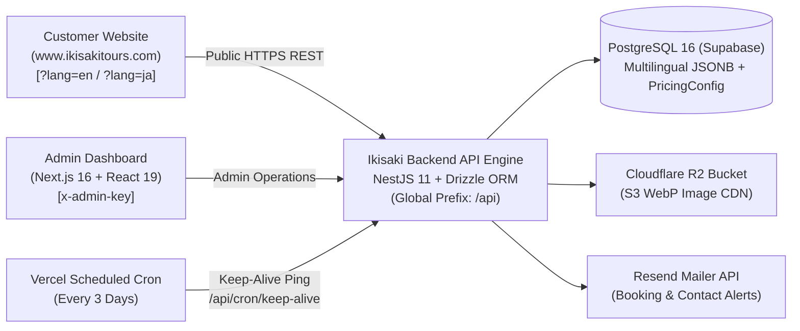

<div align="center">


# Ikisaki Tours — Enterprise Backend Engine

**Centralized Multilingual RESTful API Engine, Dynamic Pricing & Operations Service for [www.ikisakitours.com](https://www.ikisakitours.com)**

[](https://nestjs.org/)
[](https://www.typescriptlang.org/)
[](https://www.postgresql.org/)
[](https://orm.drizzle.team/)
[](https://developers.cloudflare.com/r2/)
[](https://supabase.com/)
[](https://vercel.com/)

[Live Backend API](https://ikisakitours-backend.vercel.app) · [Admin Dashboard](https://ikisakitours-admin-panel.vercel.app) · [Customer Website](https://www.ikisakitours.com) · [API Documentation](#api-service-layer-reference)

</div>

---

## Table of Contents

- [Overview](#overview)
- [System Architecture](#system-architecture)
- [Module Directory (All 15 Domains)](#module-directory-all-15-domains)
- [Core Engineering Highlights](#core-engineering-highlights)
  - [1. Unified Dynamic Group Pricing (`pricingConfig`)](#1-unified-dynamic-group-pricing-pricingconfig)
  - [2. Dual-Persona Multilingual `JSONB` Content Resolution](#2-dual-persona-multilingual-jsonb-content-resolution)
  - [3. Availability Calendar, Color-Coded Blackouts & Multi-Tour Closures](#3-availability-calendar-color-coded-blackouts--multi-tour-closures)
  - [4. Resilient Serverless Pipeline, Cloudflare R2 & Keep-Alive Cron](#4-resilient-serverless-pipeline-cloudflare-r2--keep-alive-cron)
- [API Service Layer Reference](#api-service-layer-reference)
- [Tech Stack](#tech-stack)
- [Project Structure](#project-structure)
- [Getting Started](#getting-started)
- [Database Operations](#database-operations)
- [Deployment (Vercel)](#deployment-vercel)
- [Production Readiness Checklist](#production-readiness-checklist)
- [Credits & License](#credits--license)

---

## Overview

The **Ikisaki Tours Backend Engine** is the high-performance, enterprise-grade RESTful API service powering **Ikisaki Tours** — a luxury private tour operator in Sri Lanka serving international travelers with native **English (`EN`)** and **Japanese (`JA`)** localization plus extensible multi-language capabilities.

The backend acts as the single source of truth for both the customer-facing booking web application ([www.ikisakitours.com](https://www.ikisakitours.com)) and the administrative control dashboard ([ikisakitours-admin-panel.vercel.app](https://ikisakitours-admin-panel.vercel.app)).

Engineered on **NestJS 11** and **TypeScript**, the platform utilizes **Drizzle ORM** with **PostgreSQL (Supabase)**, native `jsonb` schema structures, **Cloudflare R2** S3-compatible media distribution, and serverless edge functions on **Vercel**.

> [!TIP]
> **API Base Routing & Security:** All routes are prefixed with `/api`. Administrative mutation endpoints (POST, PATCH, DELETE) require the `x-admin-key` header matching `ADMIN_API_KEY`. Public GET endpoints automatically negotiate and return clean localized data when given `?lang=en` or `?lang=ja`.

> [!IMPORTANT]
> **Supabase Connection Pooling:** High-concurrency operations connect through the Supabase Transaction Pooler (`aws-0-ap-northeast-2.pooler.supabase.com:5432`) using `sslmode=require`. An automated 3-day serverless cron ping (`/api/cron/keep-alive`) prevents database sleep cycles.

---

## System Architecture



---

## Module Directory (All 15 Domains)

| Domain | Route Mount | Operational & Business Capabilities |
| :--- | :--- | :--- |
| **Tour Packages** | `/api/addpackages` | One-day & multi-day packages, 18 badge categories, dynamic group pricing tiers, passenger rules, custom add-ons, dynamic meals/hotels, and like counters |
| **Availability Calendar** | `/api/availability` | Central booking calendar, blackout dates, multi-color hex coding, tour-type closures, and bilingual client closure notes |
| **Destinations** | `/api/destinations` | Sri Lanka travel hubs, geographic coordinates (`lat`, `lng`), interactive map markers, photo galleries, and slug lookup |
| **Bookings & Orders** | `/api/package-bookings` | Customer tour reservations, adult/child/infant breakdown, calculated totals, and status lifecycle (`pending`, `confirmed`, `completed`, `cancelled`) |
| **Service Pricing** | `/api/service-pricing` | Supplementary service tariffs: Private Chauffeur, Airport Transfers, and Custom Tailor-Made tour rate cards |
| **Service Guidelines** | `/api/tourservice` | Vehicle specifications, capacity limits, luggage policies, and multilingual service guidelines |
| **Travel Blog CMS** | `/api/blogs` | Multilingual travel articles, auto-slugification, tag taxonomies, reader card previews, and persistent user like tracking |
| **Comments & Reviews** | `/api/comments` | Unified Website Feedback & Tour Package Reviews, star ratings, public visibility toggles, and direct Admin Replies |
| **Inquiries & Contacts**| `/api/contacts` | Customer contact form lead capture, inquiry categorization, and transactional email dispatch |
| **Legal & Compliance** | `/api/legaldocs` | Dynamic compliance CMS: Terms of Service, Privacy Policy, Cookie Policy, and Cancellation terms with client auto-translation |
| **Cookie Consent** | `/api/cookies` | GDPR & ePrivacy compliance tracking recording visitor consent choices per user identifier |
| **Customer Support** | `/api/faqs` | Categorized multilingual support Q&A pairs with admin management |
| **Newsletter Leads** | `/api/newsletter` | Email marketing lead capture with duplicate prevention and unsubscribe handling |
| **Media & Asset CDN** | `/api/uploads` | High-speed single and batch `.webp` uploads to Cloudflare R2 bucket with automated folder tagging |
| **System & Crons** | `/api/cron` | Automated Supabase pooler warmth maintenance ping avoiding free-tier inactivity timeouts |

---

## Core Engineering Highlights

### 1. Unified Dynamic Group Pricing (`pricingConfig`)

The backend pricing engine supports realistic Sri Lanka private vehicle capacities and room-sharing economics:

| Tier | Min Pax | Max Pax | Sri Lanka Vehicle Class |
| :--- | :---: | :---: | :--- |
| **Solo** | `1` | `1` | Sedan Car (Prius / Axio) |
| **Couple** | `2` | `2` | Sedan Car (1 Double/Twin Room) |
| **Small Group** | `3` | `4` | Flat-Roof Van / Mini-Van (KDH / Noah) |
| **Medium Group** | `5` | `7` | High-Roof Van (Toyota KDH High Roof) |
| **Large Group** | `8` | `15` | Mini Coach (Mitsubishi Rosa / Coaster) |
| **Coach Group** *(Optional)* | `16` | `30+` | Full-Size Luxury Coach (33–45 Seater) |

- **Passenger Category Rules**:
  - `couplePricingType`: Set to `auto_tier` (calculates 2 × couple rate) or `fixed` (flat rate).
  - `childRateType`: Set to `percentage` (e.g. `50%` of adult rate) or `fixed` dollar amount.
  - `infantPrice`: Default `$0` (free of charge for infant seating).
- **Tour Add-Ons**: Multilingual custom optional items supporting `per_person`, `per_room`, and `per_booking` (flat fee) calculation models.

<details>
<summary><strong>View Complete <code>pricingConfig</code> JSONB Schema Example</strong></summary>

```json
{
  "tiers": [
    { "minPax": 1, "maxPax": 1, "pricePerPerson": 850, "label": "Solo (1 Person)" },
    { "minPax": 2, "maxPax": 2, "pricePerPerson": 580, "label": "Couple (2 Persons)" },
    { "minPax": 3, "maxPax": 4, "pricePerPerson": 460, "label": "Small Group (3-4 Persons)" },
    { "minPax": 5, "maxPax": 7, "pricePerPerson": 390, "label": "Medium Group (5-7 Persons)" },
    { "minPax": 8, "maxPax": 15, "pricePerPerson": 320, "label": "Large Group (8-15 Persons)" }
  ],
  "passengerPricing": {
    "couplePricingType": "auto_tier",
    "coupleFixedPrice": 1160,
    "childRateType": "percentage",
    "childRateValue": 50,
    "infantPrice": 0
  },
  "options": [
    {
      "id": "opt-single-supplement",
      "name": { "en": "Single Room Accommodation Supplement", "ja": "シングルルーム（一人部屋）確約追加代金" },
      "price": 180,
      "calculationType": "per_room"
    },
    {
      "id": "opt-first-class-train",
      "name": { "en": "Scenic Blue Train 1st Class Ticket Upgrade", "ja": "絶景高原列車 1等指定席アップグレード" },
      "price": 25,
      "calculationType": "per_person"
    },
    {
      "id": "opt-vip-vehicle-upgrade",
      "name": { "en": "VIP Luxury Vehicle Upgrade (Alphard / Mercedes)", "ja": "VIPラグジュアリー車両アップグレード" },
      "price": 150,
      "calculationType": "per_booking"
    }
  ]
}
```

</details>

---

### 2. Dual-Persona Multilingual `JSONB` Content Resolution

To maximize developer ergonomics and avoid maintaining duplicate database tables for every language, text fields are stored as PostgreSQL `jsonb` locale dictionaries (`{ "en": "...", "ja": "..." }`):

- **Public Client Mode (`?lang=ja` or `?lang=en`)**: Endpoints automatically flatten and map dictionary structures into clean, single-language strings and string arrays (`getLocalizedField`, `getLocalizedArray`, `getLocalizedList`), with seamless automatic fallback to English (`en`) if a translation is pending.
- **Admin Dashboard Mode (Omitted `lang` query)**: Endpoints return raw, complete multilingual JSON dictionaries without flattening, allowing the Admin Panel to populate bilingual tabs and save text without data truncation.
- **Dynamic Array Itineraries**: Daily itinerary items store dynamic string arrays for `meals` and `accommodation` (`Record<string, string[] | string>`), enabling multiple items per day (e.g. `["Breakfast Included", "Lunch Included", "Dinner at Hotel"]`) while maintaining backward compatibility with legacy single strings.

---

### 3. Availability Calendar, Color-Coded Blackouts & Multi-Tour Closures

The availability system synchronizes closed booking dates between admin staff and customer checkout flows:
- **Date Details Grid**: Dates can be blocked for `all`, `oneday tours`, `multiday tours`, `custom made tours`, `private charter`, or `transfer`.
- **Multi-Color Visuals**: Predefined color palettes (`rose`, `emerald`, `blue`, `purple`, `gold`, `orange`, `zinc`) and custom HEX codes (`#f43f5e`, `#10b981`, etc.) for calendar badges.
- **Bilingual Reasons**: Admins input reasons in English and Japanese (`notes: { en: "Perahera Festival Holiday", ja: "ペラヘラ祭り期間のため休業" }`), and the backend dynamically resolves the appropriate `note` for client date-pickers.

---

### 4. Resilient Serverless Pipeline, Cloudflare R2 & Keep-Alive Cron

- **Cloudflare R2 Object Storage**: S3-compatible asset pipeline using `@aws-sdk/client-s3` with custom public CDN domains (`R2_PUBLIC_URL`). Zero egress bandwidth fees for heavy tour image galleries.
- **Automated Anti-Pause Cron**: Vercel Cron triggers `GET /api/cron/keep-alive` every 3 days at midnight, executing `SELECT 1` on the PostgreSQL database to keep the Supabase Free Tier project active.

---

## API Service Layer Reference

### Tour Packages & Catalog (`/api/addpackages`)
| Method | Endpoint | Auth | Description |
| :--- | :--- | :---: | :--- |
| `POST` | `/api/addpackages` | `x-admin-key` | Create a new tour package with multipart image upload & pricing config |
| `GET` | `/api/addpackages` | Public | List all package items (localized title with `?lang=`) |
| `GET` | `/api/addpackages/oneday` | Public | Paginated list of one-day tour summaries (`?page=1&limit=5&lang=en`) |
| `GET` | `/api/addpackages/multiday`| Public | Paginated list of multi-day tour summaries (`?page=1&limit=5&lang=en`) |
| `GET` | `/api/addpackages/:slug` | Public / Admin | Fetch package by slug (returns localized if `?lang=` supplied, raw if omitted) |
| `PATCH` | `/api/addpackages/:slug` | `x-admin-key` | Text-only & pricing update without re-uploading images |
| `DELETE` | `/api/addpackages/:slug`| `x-admin-key` | Delete a tour package by slug |
| `POST` | `/api/addpackages/:packageId/like` | User | Toggle like / unlike for a user on a tour package |

### Availability Calendar (`/api/availability`)
| Method | Endpoint | Auth | Description |
| :--- | :--- | :---: | :--- |
| `GET` | `/api/availability` | Public / Admin | Fetch availability (raw for admin, localized with `?lang=en`) |
| `GET` | `/api/availability/client` | Public | Explicit client UI endpoint with single-language resolution |
| `POST` | `/api/availability` | `x-admin-key` | Update blackout dates, color tags, and closure notes |

### Destinations Guide (`/api/destinations`)
| Method | Endpoint | Auth | Description |
| :--- | :--- | :---: | :--- |
| `GET` | `/api/destinations/previews` | Public | Fetch lightweight destination cards for UI carousels |
| `GET` | `/api/destinations/map` | Public | Fetch coordinate points (`lat`, `lng`) for interactive maps |
| `GET` | `/api/destinations/slug/:slug` | Public | Fetch full destination detail by slug |
| `POST` | `/api/destinations` | `x-admin-key` | Create a new destination entry |
| `DELETE` | `/api/destinations/:id` | `x-admin-key` | Remove a destination entry |

### Tour Bookings (`/api/package-bookings`)
| Method | Endpoint | Auth | Description |
| :--- | :--- | :---: | :--- |
| `POST` | `/api/package-bookings` | Public | Submit customer tour booking reservation |
| `GET` | `/api/package-bookings` | `x-admin-key` | Retrieve all customer bookings |
| `PATCH` | `/api/package-bookings/:id/status` | `x-admin-key` | Update booking status (`pending`, `confirmed`, `completed`, `cancelled`) |
| `DELETE` | `/api/package-bookings/:id` | `x-admin-key` | Remove a booking record |

### Travel Blogs (`/api/blogs`)
| Method | Endpoint | Auth | Description |
| :--- | :--- | :---: | :--- |
| `GET` | `/api/blogs/previews` | Public | Fetch blog card previews with localized titles and summaries |
| `GET` | `/api/blogs/slug/:slug` | Public | Fetch full blog post by slug |
| `POST` | `/api/blogs` | `x-admin-key` | Publish a new blog post |
| `PATCH` | `/api/blogs/:id` | `x-admin-key` | Update an existing blog post |
| `DELETE` | `/api/blogs/:id` | `x-admin-key` | Delete a blog post |
| `POST` | `/api/blogs/view` | User | Check user like status and fetch blog detail |

### Legal Documents (`/api/legaldocs` & `/api/legal-docs`)
| Method | Endpoint | Auth | Description |
| :--- | :--- | :---: | :--- |
| `GET` | `/api/legaldocs/client` | Public | Fetch all legal docs resolved to requested language |
| `GET` | `/api/legaldocs/client/:id` | Public | Fetch single legal doc (e.g. `terms`, `privacy`) by language |
| `GET` | `/api/legaldocs` | `x-admin-key` | Fetch raw multilingual legal docs for admin editing |
| `GET` | `/api/legaldocs/:id` | `x-admin-key` | Fetch raw legal doc by ID |
| `POST` | `/api/legaldocs` | `x-admin-key` | Create or upsert legal doc |
| `PATCH` | `/api/legaldocs/:id` | `x-admin-key` | Update legal doc contents |
| `DELETE` | `/api/legaldocs/:id` | `x-admin-key` | Delete a legal doc |

### Media Uploads (`/api/uploads`)
| Method | Endpoint | Auth | Description |
| :--- | :--- | :---: | :--- |
| `POST` | `/api/uploads/single` | `x-admin-key` | Upload single image to Cloudflare R2 |
| `POST` | `/api/uploads/batch` | `x-admin-key` | Batch upload up to 10 images with optional folder tag |

### Inquiries, Feedback & System
| Method | Endpoint | Auth | Description |
| :--- | :--- | :---: | :--- |
| `POST` | `/api/contacts` | Public | Submit contact / inquiry form |
| `GET` | `/api/contacts` | `x-admin-key` | List all inquiries |
| `POST` | `/api/cookies/consent` | Public | Record visitor cookie preference choices |
| `POST` | `/api/newsletter` | Public | Subscribe email address to tour updates |
| `GET` | `/api/faqs` | Public | Retrieve categorized FAQs |
| `GET` | `/api/service-pricing/client/:type` | Public | Fetch transfer / charter rate cards |
| `GET` | `/api/cron/keep-alive` | Cron / Secret | Ping database to maintain pooler warmth |

---

## Tech Stack

| Layer | Technology |
| :--- | :--- |
| **Framework** | NestJS `11.0.1` (Express Platform Adapter) |
| **Runtime & Language** | Node.js `>= 18.x / 20.x`, TypeScript `5.7+` |
| **Database** | PostgreSQL 16 (Supabase Transaction Pooler) |
| **ORM & Migrations** | Drizzle ORM `0.45.2`, Drizzle Kit `0.31.10`, `postgres` (Postgres.js) |
| **Object Storage** | Cloudflare R2 (AWS S3 SDK `@aws-sdk/client-s3`) |
| **Authentication** | Passport.js, `@nestjs/jwt`, `passport-jwt`, `passport-google-oauth20`, Bcrypt |
| **Mailer** | Resend API Client (`resend`) |
| **Validation** | `class-validator` `0.15.1`, `class-transformer` `0.5.1` |
| **Deployment** | Vercel Serverless (`@vercel/node`) + Vercel Scheduled Crons |

---

## Project Structure

<details>
<summary><strong>Click to expand repository directory tree</strong></summary>

```text
ikisakitours-backend/
├── README.md                              # Root GitHub documentation (GFM)
├── package.json                           # Dependencies & scripts
├── tsconfig.json                          # TypeScript compiler settings
├── drizzle.config.ts                      # Drizzle Kit CLI database config
├── vercel.json                            # Vercel deployment routes & crons
├── public/                                # Public brand assets & documentation media
│   └── readme-logo-rounded.webp           # Circular logo for README banner
└── src/
    ├── main.ts                            # Bootstrap, dynamic CORS, global ValidationPipe
    ├── app.module.ts                      # Application root module imports
    ├── app.controller.ts
    ├── app.service.ts
    ├── addpackages/                       # Tour packages, pricing tiers & itineraries
    │   ├── dto/                           # Create, Response, Summary & Update DTOs
    │   ├── addpackages.controller.ts
    │   ├── addpackages.module.ts
    │   └── addpackages.service.ts
    ├── availability/                      # Booking calendar & blackout date management
    ├── blogs/                             # Multilingual blog engine & likes
    ├── comments/                          # Feedback, reviews & admin replies
    ├── contacts/                          # Inquiry inbox & lead capture
    ├── cookies/                           # GDPR/ePrivacy cookie consent audit
    ├── cron/                              # Automated keep-alive maintenance controller
    ├── database/                          # Drizzle connection pool provider & schema
    │   ├── database.module.ts
    │   ├── database.provider.ts
    │   └── schema.ts                      # Central PostgreSQL table declarations
    ├── destinations/                      # Destination hubs & coordinate map points
    ├── email/                             # Email service & Resend templates
    ├── faqs/                              # Categorized multilingual FAQ repository
    ├── legaldocs/                         # Dynamic legal CMS (Terms, Privacy, Policies)
    ├── newsletter/                        # Subscriber lead management
    ├── packagebooking/                    # Reservation checkout & status lifecycle
    ├── servicepricing/                    # Charters, custom tours & transfer rate cards
    ├── social-auth/                       # OAuth2 social sign-in providers
    ├── tours/                             # Core tour catalog management
    ├── tourservice/                       # Supplementary travel service guidelines
    ├── uploads/                           # Cloudflare R2 media upload service
    └── users/                             # User authentication, roles & profiles
```

</details>

---

## Getting Started

### Prerequisites

- **Node.js** `>= 18.x` (v20+ recommended)
- **npm** `>= 9.x`
- A **PostgreSQL** database (Supabase project recommended)
- A **Cloudflare R2** bucket with API access keys

### 1. Clone & Install

```bash
git clone https://github.com/your-org/ikisakitours-backend.git
cd ikisakitours-backend
npm install
```

### 2. Configure Environment Variables

Create `.env` in the root directory:

| Variable | Required | Description |
| :--- | :---: | :--- |
| `DATABASE_URL` | Yes | PostgreSQL connection string (Supabase Transaction Pooler, port `5432` or `6543`) |
| `DIRECT_URL` | Yes | Direct PostgreSQL connection string for Drizzle migrations |
| `ADMIN_API_KEY` | Yes | Secret key required in the `x-admin-key` header for administrative endpoints |
| `JWT_SECRET` | Yes | Secret key used to sign and verify JSON Web Tokens |
| `R2_ACCOUNT_ID` | Yes | Cloudflare Account ID |
| `R2_ACCESS_KEY_ID` | Yes | Cloudflare R2 S3 Access Key ID |
| `R2_SECRET_ACCESS_KEY`| Yes | Cloudflare R2 S3 Secret Access Key |
| `R2_BUCKET_NAME` | Yes | Cloudflare R2 storage bucket name |
| `R2_PUBLIC_URL` | Yes | Public CDN URL endpoint of the Cloudflare R2 bucket |
| `GOOGLE_CLIENT_ID` | Optional | Google OAuth 2.0 Client ID for social authentication |
| `GOOGLE_CLIENT_SECRET`| Optional | Google OAuth 2.0 Client Secret |
| `FRONTEND_URL` | Yes | Canonical public customer website origin (e.g. `https://www.ikisakitours.com`) |
| `ADMINPANEL_URL` | Yes | Admin Dashboard origin (e.g. `https://ikisakitours-admin-panel.vercel.app`) |
| `CRON_SECRET` | Optional | Bearer secret token to authorize manual cron executions |

```env
DATABASE_URL="postgresql://postgres.<project-id>:<password>@aws-0-ap-northeast-2.pooler.supabase.com:5432/postgres?sslmode=require"
DIRECT_URL="postgresql://postgres.<project-id>:<password>@aws-0-ap-northeast-2.pooler.supabase.com:5432/postgres?sslmode=require"
PORT=4000
NODE_ENV=development

ADMIN_API_KEY="your_secure_admin_api_key_here"
JWT_SECRET="your_jwt_secret_key_here"

R2_ACCOUNT_ID="your_cloudflare_account_id"
R2_ACCESS_KEY_ID="your_r2_access_key_id"
R2_SECRET_ACCESS_KEY="your_r2_secret_access_key"
R2_BUCKET_NAME="ikisaki-tours-storage"
R2_PUBLIC_URL="https://pub-your-id.r2.dev"

GOOGLE_CLIENT_ID="your-google-client-id.apps.googleusercontent.com"
GOOGLE_CLIENT_SECRET="your-google-client-secret"

FRONTEND_URL="https://www.ikisakitours.com"
ADMINPANEL_URL="https://ikisakitours-admin-panel.vercel.app"
CRON_SECRET="your_cron_verification_secret"
```

> [!CAUTION]
> Never commit `.env` or production credentials to Git. Add `.env` to `.gitignore`.

### 3. Start Development Server

```bash
# Start NestJS in watch mode (http://localhost:4000/api)
npm run start:dev

# Run strict TypeScript build
npm run build

# Start production server
npm run start:prod
```

---

## Database Operations

The database schema is declared in [`src/database/schema.ts`](file:///C:/Users/HP/Desktop/Asmith/ikisakitours-backend/src/database/schema.ts) using Drizzle ORM.

### Push Schema Changes
To push TypeScript table definitions directly to your PostgreSQL database:

```bash
npx drizzle-kit push
```

### Direct Supabase SQL Migration (Recommended for Pooler Timeouts)
If your Supabase connection times out over the pooler, execute column updates directly in the **Supabase SQL Editor**:

```sql
-- Pricing Configuration
ALTER TABLE "packages" ADD COLUMN IF NOT EXISTS "pricing_config" jsonb;

-- Availability Details
ALTER TABLE "availability" 
ADD COLUMN IF NOT EXISTS "date_details" jsonb DEFAULT '{}'::jsonb NOT NULL,
ADD COLUMN IF NOT EXISTS "closed_date_details" jsonb DEFAULT '[]'::jsonb NOT NULL;
```

---

## Deployment (Vercel)

The backend is configured for zero-config serverless deployment via [`vercel.json`](file:///C:/Users/HP/Desktop/Asmith/ikisakitours-backend/vercel.json):

1. Import the repository into **Vercel**.
2. Add all environment variables from `.env` under **Project Settings → Environment Variables**.
3. Deploy — Vercel builds the entry point [`src/main.ts`](file:///C:/Users/HP/Desktop/Asmith/ikisakitours-backend/src/main.ts) using `@vercel/node`.
4. Automated 3-day cron jobs will automatically register at `/api/cron/keep-alive`.

---

## Production Readiness Checklist

- [x] NestJS `11.0.1` + TypeScript `5.7+` compilation verified with `0` errors (`npm run build`)
- [x] Unified `pricingConfig` (Group Discount Tiers + Passenger Category Rules + Custom Add-Ons) live
- [x] Dynamic multilingual itinerary arrays (`meals[]` & `accommodation[]`) with backward compatibility
- [x] Dual-persona content resolution (Client single language vs Admin raw dictionary)
- [x] Calendar availability blackout dates with multi-color badges & bilingual closure notes
- [x] Cloudflare R2 S3-compatible single and batch image upload pipeline
- [x] Dynamic CORS regex whitelist (`*.ikisakitours.com`, `*.vercel.app`, `localhost:3000`, `localhost:3001`)
- [x] Automated 3-day keep-alive cron job configured to prevent Supabase pooler inactivity sleep

---

## Credits & License

| Attribute | Details |
| :--- | :--- |
| **Client & Owner** | **Ikisaki Tours (Pvt) Ltd** — [www.ikisakitours.com](https://www.ikisakitours.com) |
| **Powered By** | **Aetheria Labs** |
| **Engineered By** | **Pramod_Siriwardhana** & **Shehan_W** |
| **License** | All rights reserved © 2026 Ikisaki Tours (Pvt) Ltd |
| **Organization** | Ikisaki Tours (Pvt) Ltd |
| **License** | All rights reserved © 2026 Ikisaki Tours (Pvt) Ltd |

> [!IMPORTANT]
> **Proprietary Software Notice:** This application and its source code are private, proprietary assets built exclusively for the internal operations of **Ikisaki Tours (Pvt) Ltd**. Unauthorized copying, modification, redistribution, or commercial use of any part of this repository without prior written consent is strictly prohibited.

> [!NOTE]
> **Copyright © 2026 Ikisaki Tours (Pvt) Ltd. All rights reserved.**  
> This repository and its source code, design assets, and localization dictionaries are proprietary and confidential. Unauthorized copying, redistribution, modification, or commercial use is strictly prohibited without prior written consent from Ikisaki Tours (Pvt) Ltd. See [`LICENSE`](./LICENSE) for full terms.
---

<div align="center">

**© 2026 Ikisaki Tours (Pvt) Ltd** · Powered by **Aetheria Labs** · Engineered by **Pramod_Siriwardhana** & **Shehan_W**

</div>

